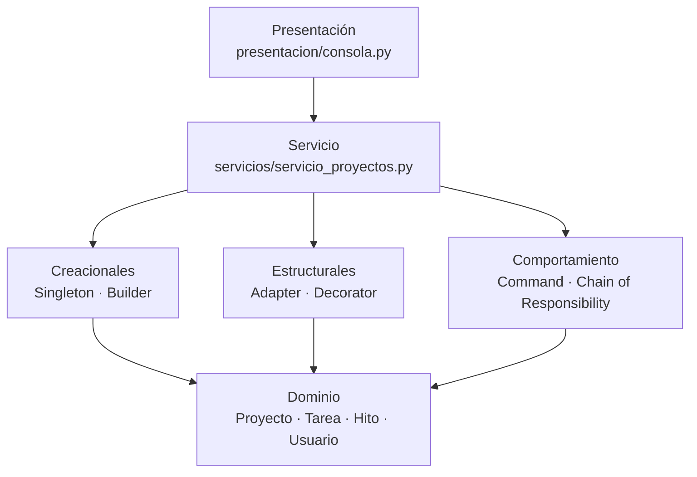
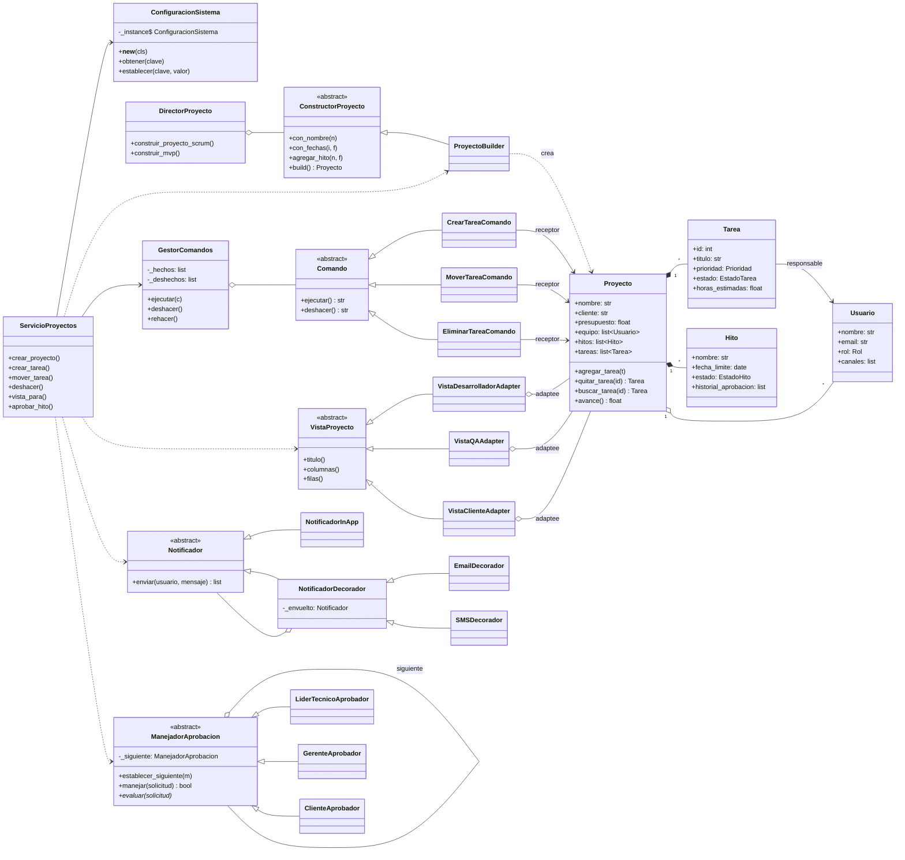
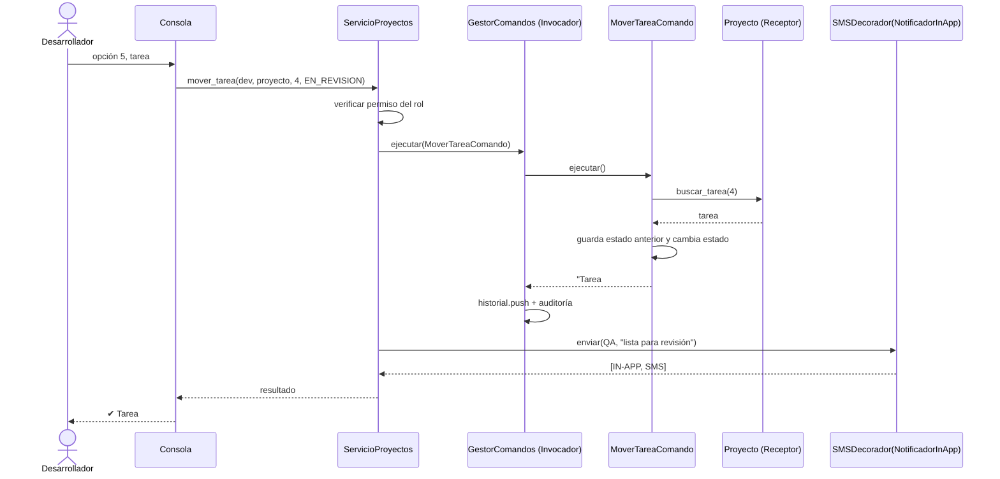
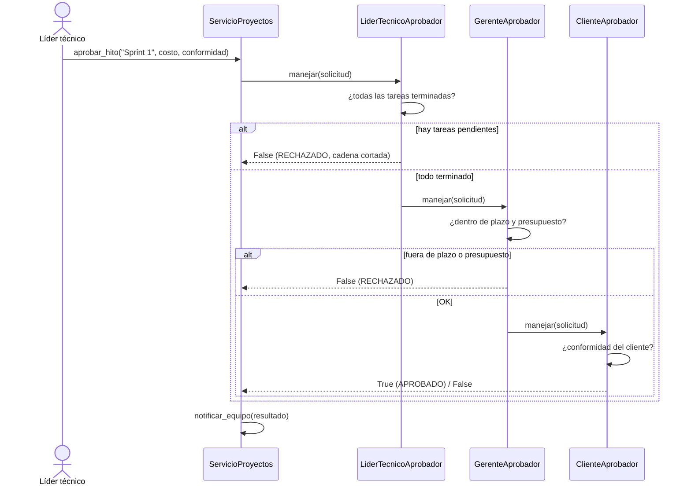
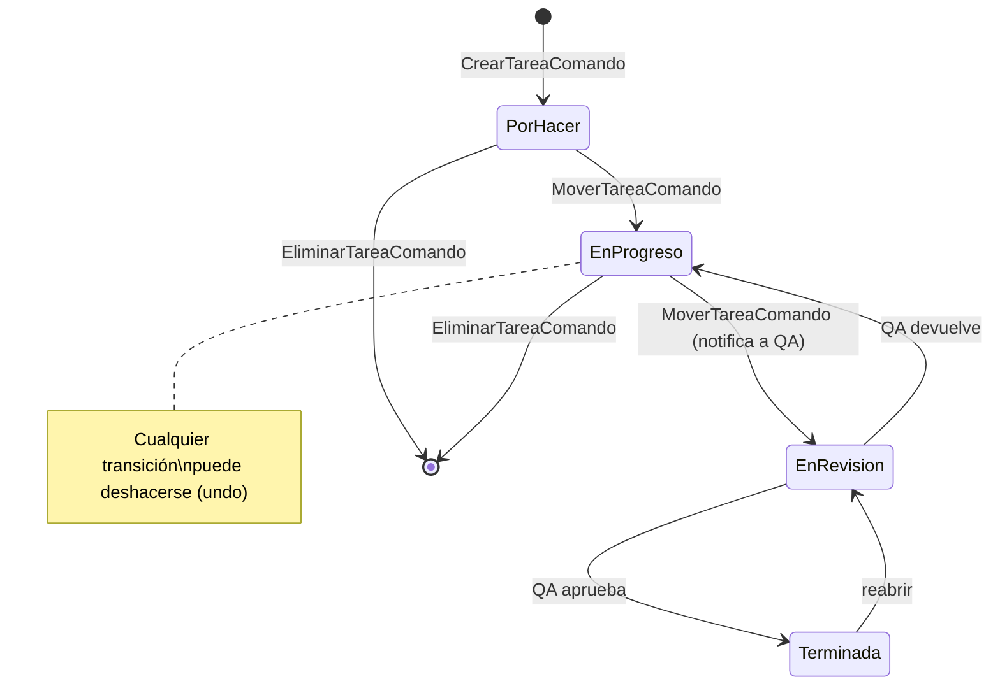
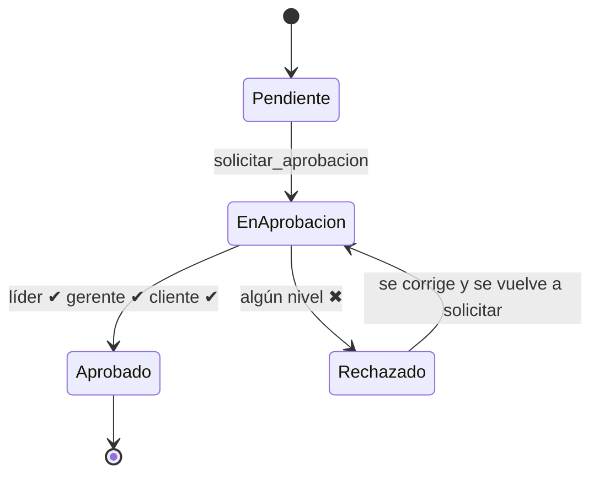
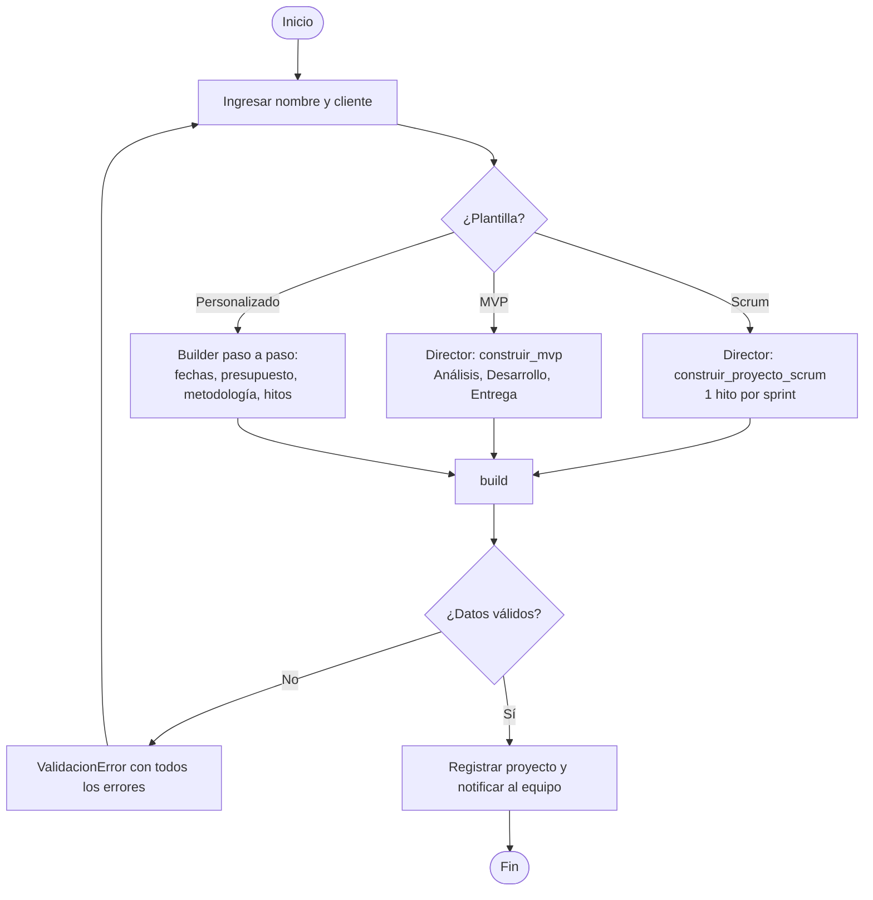

# 2. Diseño — Diagramas UML

Los diagramas están en sintaxis **Mermaid** (GitHub los dibuja automáticamente).

## 2.1 Arquitectura en capas

La presentación solo conoce al servicio. El servicio orquesta los patrones. Los patrones
trabajan sobre el dominio, que no depende de nadie.

## 2.2 Diagrama de clases

## 2.3 Diagrama de secuencia — Mover tarea a revisión (Command + Decorator)

## 2.4 Diagrama de secuencia — Aprobación de hito (Chain of Responsibility)

## 2.5 Diagrama de estados — Tarea

## 2.6 Diagrama de estados — Hito

## 2.7 Diagrama de actividad — Crear proyecto (Builder)

